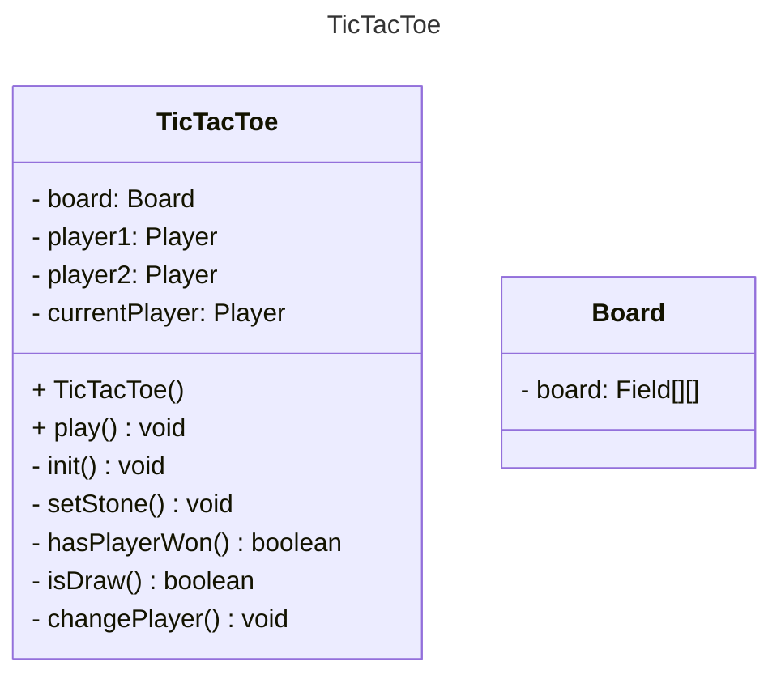
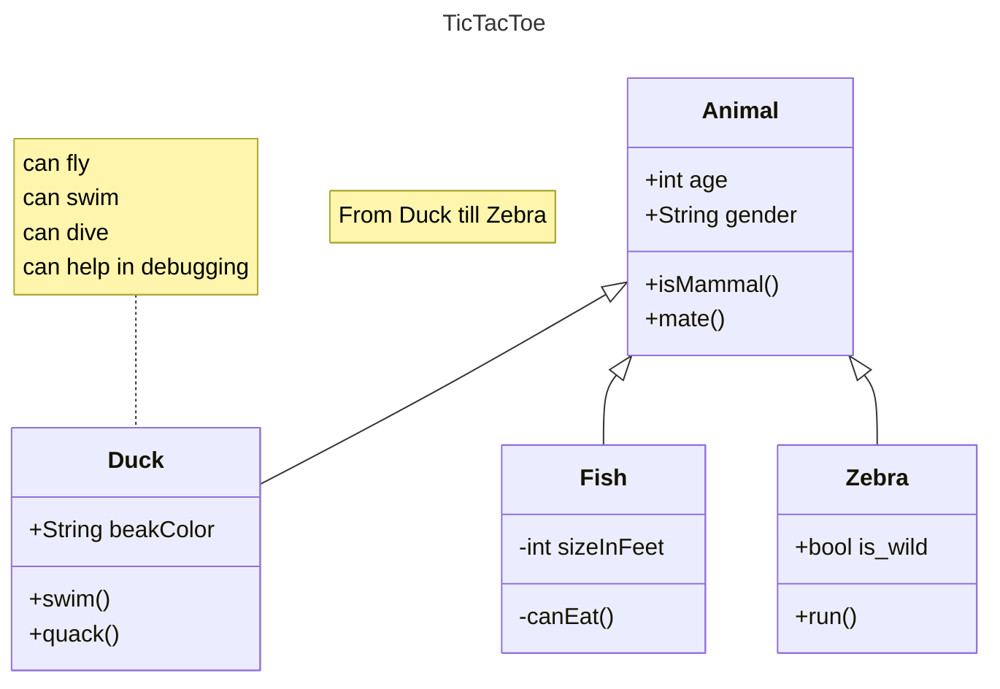

3x3 Feld
abwechselndes setzen eines 'X' oder 'O'
sollte es einem Spieler gelingen 3 seiner Zeichen in einer Linie anzuordnen, horizontal, vertical oder diagonal
wenn alle Felder gefüllt sind, und line 3 nicht erfüllt ist, Patt

Spielfeld erstellen (anfangs leer)
Spieler setzen abwechselnd Symbole 
Bei jedem Spielfeld 

UMLet

